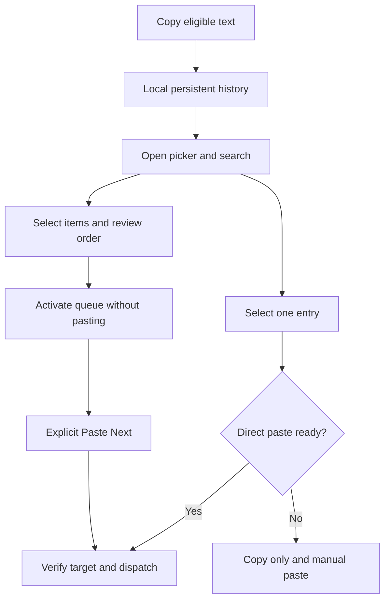
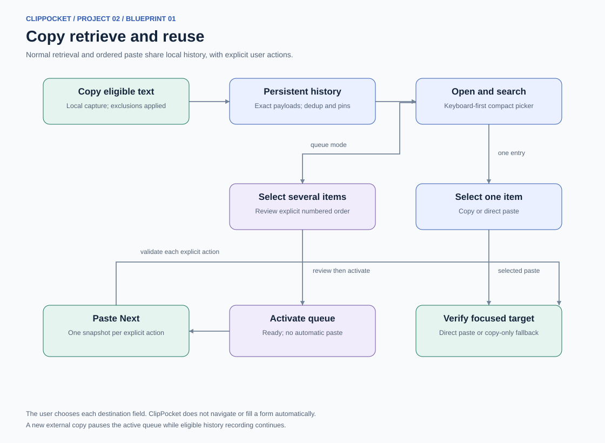
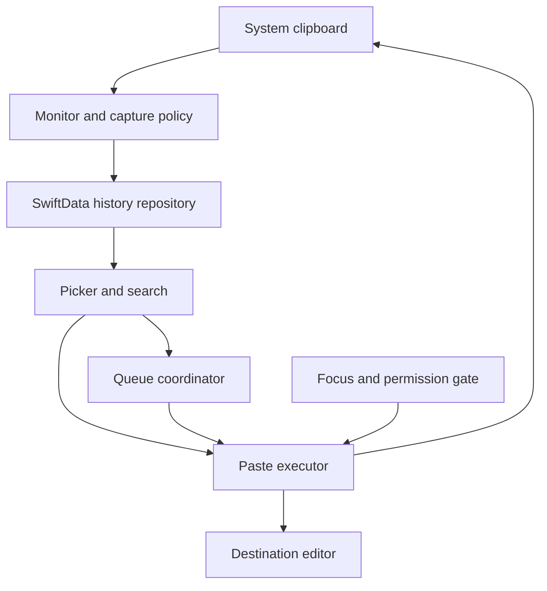
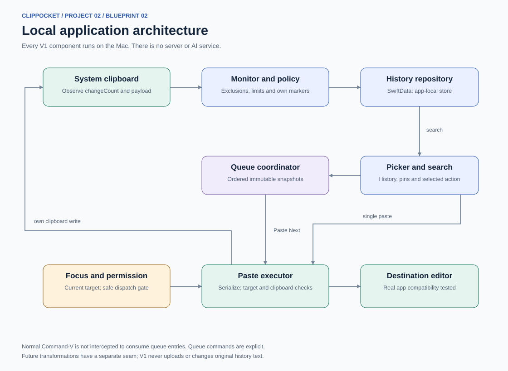
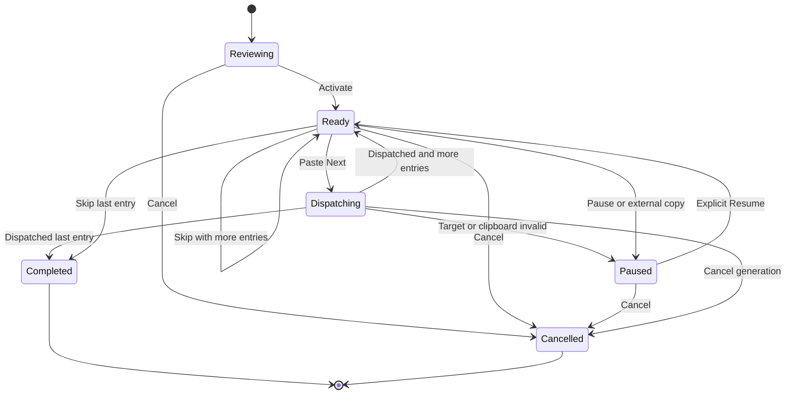
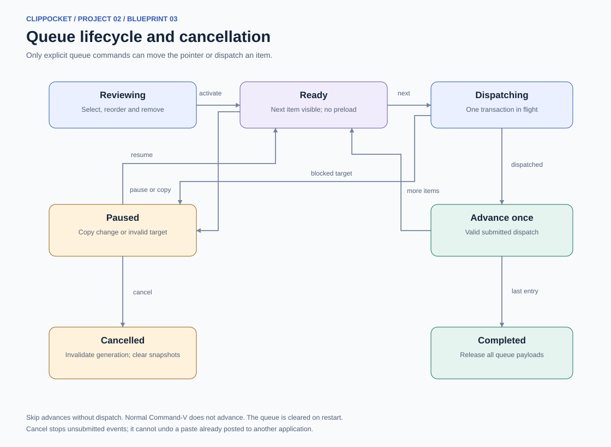
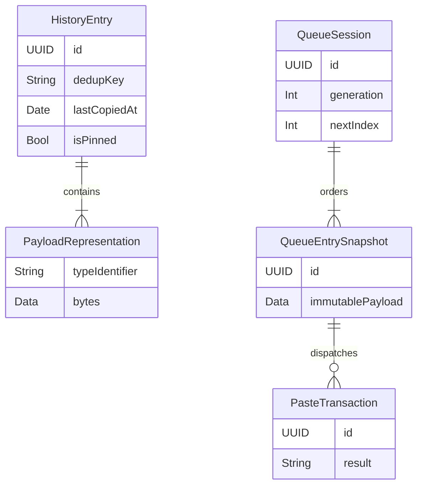
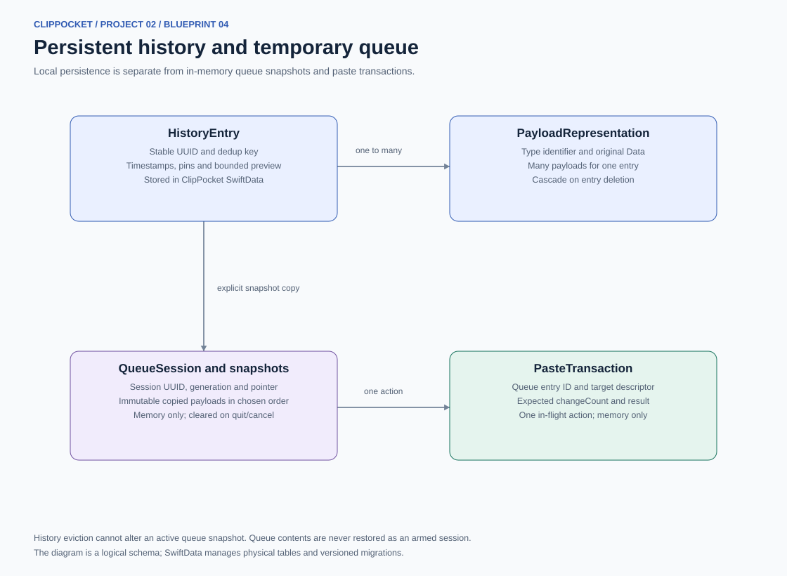
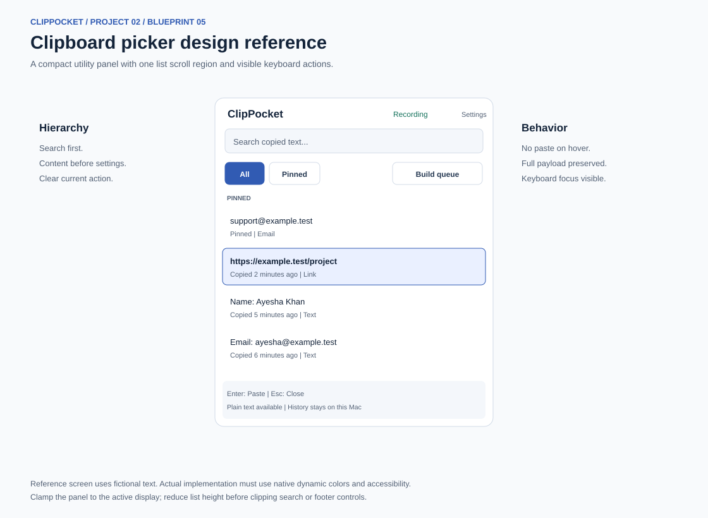
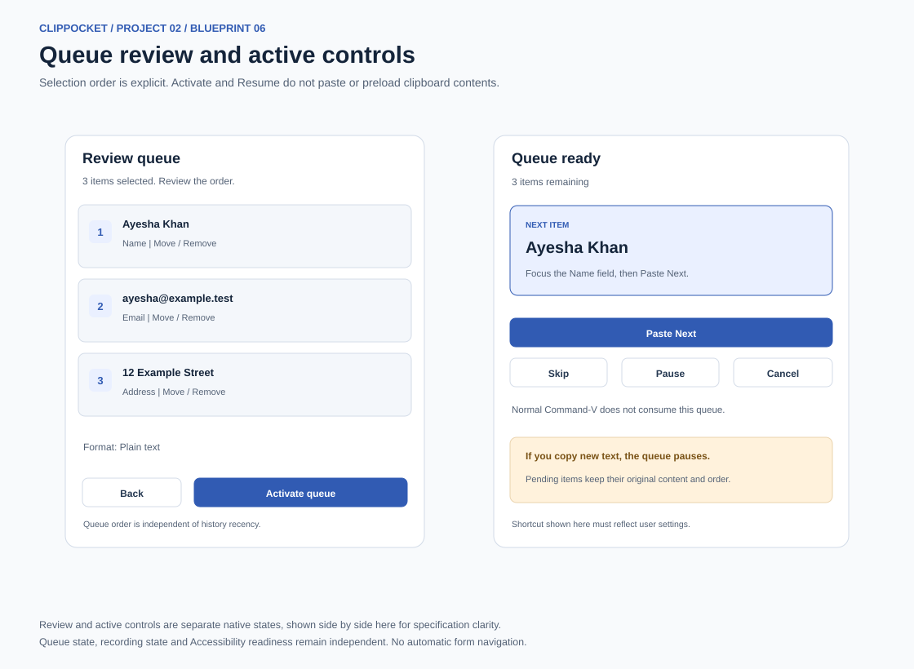

# ClipPocket diagrams and design references

Proposed behavior and UI, not screenshots of an implemented application. Mermaid diagrams remain editable; SVG/PDF versions are bundled for direct viewing.

## 1 Copy retrieve and reuse

Normal retrieval and ordered paste share local history, with explicit user actions.

The user chooses each destination field. ClipPocket does not navigate or fill a form automatically.

A new external copy pauses the active queue while eligible history recording continues.

## 2 Local application architecture

Every V1 component runs on the Mac. There is no server or AI service.

Normal Command-V is not intercepted to consume queue entries. Queue commands are explicit.

Future transformations have a separate seam; V1 never uploads or changes original history text.

## 3 Queue lifecycle and cancellation

Only explicit queue commands can move the pointer or dispatch an item.

Skip advances without dispatch. Normal Command-V does not advance. The queue is cleared on restart.

Cancel stops unsubmitted events; it cannot undo a paste already posted to another application.

## 4 Persistent history and temporary queue

Local persistence is separate from in-memory queue snapshots and paste transactions.

History eviction cannot alter an active queue snapshot. Queue contents are never restored as an armed session.

The diagram is a logical schema; SwiftData manages physical tables and versioned migrations.

## 5 Clipboard picker design reference

Reference only. Use native controls, dynamic colors and the detailed UI brief.

## 6 Queue review and active controls

Two separate runtime states shown side by side for comparison. Native app uses the appropriate state, not two permanent windows.
